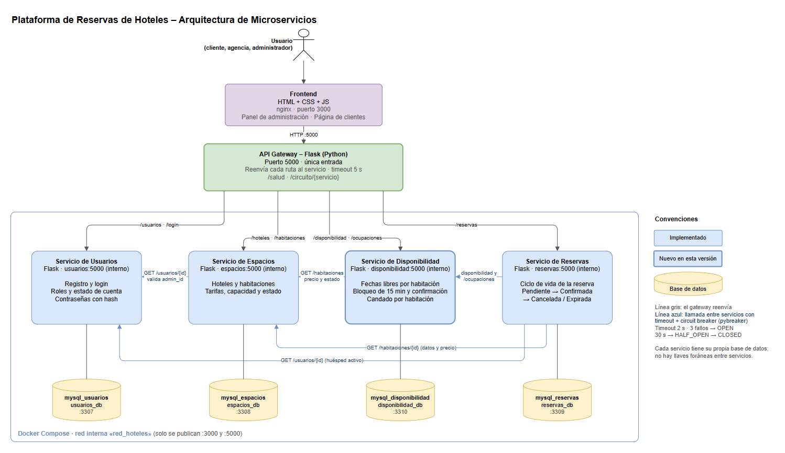

# Sistema de Reserva de Hoteles

**Hoteles Cauca**: sistema de reserva de hoteles basado en microservicios (Sistemas Distribuidos, Unicomfacauca). Tercer avance: integración completa, CRUD, persistencia y tolerancia a fallos.

## 1. Descripción del sistema

### Problema que resuelve

Buscar hotel y comprobar qué habitaciones están libres en unas fechas suele implicar llamar o revisar cada hotel por separado, y es fácil que dos personas reserven la misma habitación a la vez.

Este sistema reúne en un solo lugar los hoteles y sus habitaciones, calcula la disponibilidad por fechas y aparta la habitación durante 15 minutos mientras se completa una reserva, para evitar reservas duplicadas.

### Funcionalidades principales

- Registro, inicio de sesión y roles (`cliente`, `agencia`, `admin_hotel`, `admin_sistema`).
- Catálogo de hoteles y habitaciones con tarifa, capacidad y estado.
- Búsqueda de habitaciones libres por ciudad, fechas y número de huéspedes.
- Reserva con bloqueo de 15 minutos, confirmación, cambio de fechas, cancelación y vencimiento automático.
- Página de clientes (buscar y reservar) y panel de administración (CRUD de todos los servicios y estado de los circuit breakers).

## 2. Arquitectura completa



> El PNG trae el diagrama incrustado: se puede abrir y editar en draw.io (diagrams.net). La descripción de cada servicio está en [docs/Arquitectura/definicion-servicios.md](docs/Arquitectura/definicion-servicios.md).

- El navegador solo habla con el **API Gateway** (puerto 5000). El gateway reenvía cada ruta al servicio que corresponde.
- Cuatro microservicios Flask (Python), **cada uno con su propia base de datos MySQL 8.0**.
- Los servicios se llaman entre sí por HTTP con **timeout y circuit breaker** (`pybreaker`).
- Todo se ejecuta con **Docker Compose** en la red interna que crea por defecto.

### Cambios de arquitectura respecto al segundo avance

| Cambio | Motivo técnico |
| --- | --- |
| Se separó **Disponibilidad** de Espacios | El cálculo de fechas libres y los bloqueos de 15 minutos crecían dentro de Espacios. Al separarlos, Espacios solo administra el catálogo y Disponibilidad lleva el calendario de ocupación con su propia base de datos. |
| El **API Gateway** pasó de NGINX a **Flask** | Permite manejar errores (`503`/`504`), timeout y la ruta `/salud`, siguiendo el estilo del curso. |
| Se quitaron Pagos y Notificaciones | Estaban como "Fase 2" y no hacen parte del alcance de este proyecto. |
| Los microservicios ya no publican puertos | Solo el frontend (3000) y el gateway (5000) quedan expuestos; ver [Docker Compose](#10-docker-compose). |

### Estructura del repositorio

```
hoteles/
├── docker-compose.yml
├── .env.example          # plantilla de variables (.env no se sube a git)
├── frontend/             # vista Home: página de clientes y panel de administración (nginx)
├── gateway/              # API Gateway (app.py, Dockerfile, requirements.txt)
├── base_de_datos/        # scripts SQL de creación de tablas, uno por servicio
├── usuarios/             # servicio de Usuarios (app.py, database.py, Dockerfile)
├── espacios/             # servicio de Espacios: hoteles y habitaciones
├── disponibilidad/       # servicio de Disponibilidad: ocupaciones y fechas libres
├── reservas/             # servicio de Reservas
└── docs/
    ├── Arquitectura/     # diagrama y definición de servicios
    └── endpoints/        # colección de Thunder Client
```

## 3. Microservicios

### Inventario de servicios

| Microservicio | Responsabilidad | Base de datos | Comunicación con otros servicios | Estado |
| --- | --- | --- | --- | --- |
| **API Gateway** | Punto de entrada único: reenvía cada ruta al servicio que corresponde, conserva el código de estado y reporta la salud de todos | No guarda datos | Usuarios, Espacios, Disponibilidad, Reservas | ✅ Implementado |
| **Usuarios** | Registrar y administrar personas, roles y estado de cuenta; iniciar sesión | `usuarios_db` | Ninguna saliente | ✅ Implementado |
| **Espacios** | Administrar hoteles y habitaciones (tarifa, capacidad, estado) | `espacios_db` | Usuarios (valida el administrador del hotel) | ✅ Implementado |
| **Disponibilidad** | Calcular habitaciones libres; apartar, confirmar, cambiar y liberar fechas | `disponibilidad_db` | Espacios (habitaciones candidatas y precio) | ✅ Implementado |
| **Reservas** | Ciclo de vida de la reserva: crear, confirmar, cambiar fechas, cancelar, vencer, eliminar | `reservas_db` | Usuarios, Espacios, Disponibilidad | ✅ Implementado |
| **Frontend (Home)** | Página de clientes y panel de administración | No guarda datos | API Gateway | ✅ Implementado |

### Flujo de una reserva

1. El cliente busca: `GET /disponibilidad/hoteles?...`. Disponibilidad pide las habitaciones a Espacios y descarta las ocupadas.
2. Crea la reserva: `POST /reservas`. Reservas valida el usuario (Usuarios), la habitación y su capacidad (Espacios) y la disponibilidad; aparta las fechas en Disponibilidad (bloqueo de 15 minutos) y guarda la reserva como `pendiente`.
3. Confirma: `POST /reservas/{id}/confirmar`. Disponibilidad convierte el bloqueo en ocupación confirmada. Si pasaron los 15 minutos, la reserva queda `expirada`.
4. Si cancela: `POST /reservas/{id}/cancelar` libera las fechas en Disponibilidad.

**Reservas duplicadas:** al apartar una habitación, Disponibilidad toma un candado de MySQL por habitación (`GET_LOCK`). Si dos personas apartan la misma habitación a la vez, la segunda espera a que la primera termine, ve el bloqueo recién creado y recibe `409`.

## 4. Endpoints

Todas las rutas se usan a través del gateway: `http://localhost:5000`. Las respuestas son JSON; los errores traen un campo `Mensaje`. En [docs/endpoints](docs/endpoints/) hay una colección de Thunder Client lista para importar.

### Servicio Usuarios

| Método | Endpoint | Descripción | Entrada | Respuesta |
| --- | --- | --- | --- | --- |
| GET | /usuarios | Consultar usuarios | Ninguna | Lista de usuarios |
| GET | /usuarios/{id} | Consultar un usuario | ID del usuario | Usuario, o 404 |
| POST | /usuarios | Crear usuario | JSON: nombre, apellido, correo, password; opcionales telefono y rol | Id (201); 400 si faltan campos; 409 si el correo ya existe |
| PUT | /usuarios/{id} | Actualizar usuario | JSON con nombre, apellido, telefono y/o rol | Confirmación, o 404 |
| PATCH | /usuarios/{id}/estado | Activar o desactivar la cuenta | JSON: `{"estado":"activa"}` o `"inactiva"` | Confirmación, o 404 |
| DELETE | /usuarios/{id} | Eliminar usuario | ID del usuario | Confirmación, o 404 |
| POST | /login | Iniciar sesión | JSON: correo, password | Usuario (sin contraseña); 401 datos incorrectos; 403 cuenta inactiva |

### Servicio Espacios

| Método | Endpoint | Descripción | Entrada | Respuesta |
| --- | --- | --- | --- | --- |
| GET | /hoteles | Consultar hoteles activos | Opcional: `?ciudad=`; `?todos=1` incluye los inactivos | Lista de hoteles |
| GET | /hoteles/{id} | Consultar un hotel | ID del hotel | Hotel con sus habitaciones, o 404 |
| POST | /hoteles | Crear hotel | JSON: admin_id, nombre, ciudad; opcionales direccion, descripcion, servicios, telefono, correo | Id (201); 400 si el administrador no existe |
| PUT | /hoteles/{id} | Actualizar hotel | JSON con los campos a cambiar | Confirmación, o 404 |
| DELETE | /hoteles/{id} | Eliminar hotel y sus habitaciones | ID del hotel | Confirmación, o 404 |
| POST | /hoteles/{id}/habitaciones | Crear habitación en un hotel | JSON: numero, tipo, capacidad, precio_noche; opcional amenidades | Id (201); 409 si el número ya existe |
| GET | /habitaciones | Habitaciones activas de hoteles activos | Opcional: `?ciudad=` y `?capacidad=` | Lista con hotel y ciudad |
| GET | /habitaciones/{id} | Consultar una habitación | ID de la habitación | Habitación con su hotel, o 404 |
| PUT | /habitaciones/{id} | Actualizar habitación | JSON con tipo, capacidad, precio_noche, amenidades y/o estado | Confirmación, o 404 |
| DELETE | /habitaciones/{id} | Eliminar habitación | ID de la habitación | Confirmación, o 404 |
| GET | /circuito | Circuit breaker hacia Usuarios | Ninguna | Estado y fallos del circuito |

### Servicio Disponibilidad

| Método | Endpoint | Descripción | Entrada | Respuesta |
| --- | --- | --- | --- | --- |
| GET | /disponibilidad/hoteles | Buscar hoteles con habitaciones libres | `?entrada=&salida=` (AAAA-MM-DD), opcional `huespedes` y `ciudad` | Hoteles con habitaciones libres y precio total |
| GET | /disponibilidad/habitaciones/{id} | ¿Está libre la habitación? | `?entrada=&salida=` | `disponible`, noches y precio total |
| GET | /ocupaciones | Consultar ocupaciones | Opcional: `?habitacion_id=` | Lista de ocupaciones |
| GET | /ocupaciones/{id} | Consultar una ocupación | ID | Ocupación, o 404 |
| POST | /ocupaciones | Apartar fechas 15 minutos | JSON: habitacion_id, entrada, salida | `ocupacion_id` (201); 400 fechas inválidas; 409 ya ocupada |
| PUT | /ocupaciones/{id} | Cambiar las fechas | JSON: entrada, salida | Confirmación; 404; 409 si se cruzan |
| POST | /ocupaciones/{id}/confirmar | Convertir el bloqueo en ocupación confirmada | JSON: `{"reserva_id":10}` | Confirmación, o 404 si venció |
| DELETE | /ocupaciones/{id} | Liberar las fechas | ID | Confirmación, o 404 |
| GET | /circuito | Circuit breaker hacia Espacios | Ninguna | Estado y fallos del circuito |

### Servicio Reservas

| Método | Endpoint | Descripción | Entrada | Respuesta |
| --- | --- | --- | --- | --- |
| GET | /reservas | Consultar reservas | Opcional: `?usuario_id=` y `?estado=` | Lista de reservas |
| GET | /reservas/{id} | Consultar una reserva | ID | Reserva, o 404 |
| POST | /reservas | Crear reserva (queda `pendiente`) | JSON: usuario_id, habitacion_id, entrada, salida; opcional huespedes | Id y total (201); 400 datos inválidos; 409 habitación ocupada |
| PUT | /reservas/{id} | Cambiar las fechas | JSON: entrada, salida | Nuevo total; 404; 409 si se cruzan |
| DELETE | /reservas/{id} | Eliminar la reserva y liberar sus fechas | ID | Confirmación, o 404 |
| POST | /reservas/{id}/confirmar | Confirmar la reserva pendiente | ID | Confirmación, o 409 si ya venció |
| POST | /reservas/{id}/cancelar | Cancelar y liberar las fechas (se conserva el registro) | ID | Confirmación, o 409 si ya estaba cancelada |
| GET | /circuito | Circuit breakers hacia Usuarios, Espacios y Disponibilidad | Ninguna | Estado y fallos de cada circuito |

Estados de una reserva: `pendiente` (vence a los 15 minutos), `confirmada`, `cancelada` y `expirada`.

**Operaciones que no son CRUD tradicional (justificación):** `POST /login` autentica sin crear un recurso. `PATCH /usuarios/{id}/estado` activa o desactiva sin borrar el historial. `GET /disponibilidad/...` es un cálculo sobre las ocupaciones, no un registro. Los `POST .../confirmar` y `.../cancelar` son cambios de estado del ciclo de vida de una reserva que, además, coordinan a otro servicio.

## 5. Bases de datos

| Microservicio | Base de datos | Tablas principales | Operaciones implementadas |
| --- | --- | --- | --- |
| Usuarios | `usuarios_db` (contenedor `mysql_usuarios`) | `usuarios` | INSERT, SELECT, UPDATE, DELETE; login con hash |
| Espacios | `espacios_db` (contenedor `mysql_espacios`) | `hoteles`, `habitaciones` | INSERT, SELECT (con JOIN hotel–habitación), UPDATE, DELETE |
| Disponibilidad | `disponibilidad_db` (contenedor `mysql_disponibilidad`) | `ocupaciones` | INSERT, SELECT por cruce de fechas, UPDATE, DELETE; candado `GET_LOCK` |
| Reservas | `reservas_db` (contenedor `mysql_reservas`) | `reservas` | INSERT, SELECT, UPDATE de estado y fechas, DELETE |

- Cada servicio se conecta solo a su base de datos (`database.py`), configurada con variables de entorno (`DB_HOST`, `DB_NAME`, `DB_USER`, `DB_PASSWORD`).
- **No hay llaves foráneas entre servicios.** `hoteles.admin_id`, `ocupaciones.habitacion_id` y los ids guardados en `reservas` apuntan a datos de otro servicio y se validan llamando a su API, nunca con SQL sobre la base ajena.
- Las tablas se crean con los scripts de [base_de_datos/](base_de_datos/) (`usuarios.sql`, `espacios.sql`, `disponibilidad.sql`, `reservas.sql`). Los de usuarios y espacios traen datos de prueba.
- Docker Compose monta cada script en `/docker-entrypoint-initdb.d` de su MySQL, así que las tablas se crean solas la primera vez que se levanta el contenedor con el volumen vacío.

## 6. Persistencia

Cada MySQL guarda sus datos en un volumen de Docker (`datos_usuarios`, `datos_espacios`, `datos_disponibilidad`, `datos_reservas`). Los datos sobreviven a `docker compose down`, a `stop`/`start` y a recrear los contenedores. Solo se pierden con `docker compose down -v`.

Prueba realizada:

```bash
docker compose up -d --force-recreate usuarios espacios disponibilidad reservas
# el usuario, el hotel y la reserva creados antes siguen respondiendo 200
```

## 7. Comunicación entre servicios

Dentro de Docker Compose cada servicio se alcanza por su **nombre** en la red de Docker Compose (por ejemplo `http://espacios:5000`). Las direcciones están en `.env` (`USUARIOS_URL`, `ESPACIOS_URL`, `DISPONIBILIDAD_URL`, `RESERVAS_URL`) y cada `app.py` las lee con `os.getenv`.

| Servicio solicitante | Servicio destino | Endpoint | Método | Información intercambiada |
| --- | --- | --- | --- | --- |
| Espacios | Usuarios | `/usuarios/{id}` | GET | Existencia del administrador del hotel (`POST /hoteles`) |
| Disponibilidad | Espacios | `/habitaciones?ciudad=&capacidad=` | GET | Habitaciones candidatas con precio, capacidad y hotel |
| Disponibilidad | Espacios | `/habitaciones/{id}` | GET | Existencia, estado y precio de una habitación |
| Reservas | Usuarios | `/usuarios/{id}` | GET | Que el huésped exista y su cuenta esté activa |
| Reservas | Espacios | `/habitaciones/{id}` | GET | Hotel, número, tipo, capacidad y precio por noche |
| Reservas | Disponibilidad | `/disponibilidad/habitaciones/{id}` | GET | Si está libre y el precio total |
| Reservas | Disponibilidad | `/ocupaciones` | POST | Apartar las fechas (devuelve `ocupacion_id`) |
| Reservas | Disponibilidad | `/ocupaciones/{id}/confirmar` | POST | Confirmar las fechas con el `reserva_id` |
| Reservas | Disponibilidad | `/ocupaciones/{id}` | PUT / DELETE | Cambiar o liberar las fechas |

## 8. Manejo de errores y tolerancia a fallos

### Códigos HTTP

| Situación | Código |
| --- | --- |
| Solicitud correcta | `200` |
| Recurso creado | `201` |
| Datos inválidos o faltantes | `400` |
| Credenciales incorrectas / cuenta inactiva | `401` / `403` |
| Recurso o ruta inexistente | `404` |
| Método no permitido | `405` |
| Conflicto (fechas ocupadas, correo repetido, reserva vencida) | `409` |
| Error interno | `500` |
| El servicio dependiente respondió con error 5xx | `502` |
| Dependencia no disponible o circuito abierto | `503` |
| Tiempo de espera agotado | `504` |

Un recurso inexistente en otro servicio no se trata como caída: si Usuarios responde `404`, Reservas devuelve `400` ("el usuario no existe") y el circuito no cuenta un fallo.

### Timeout

Los valores están en `.env` y cada `app.py` los lee con `os.getenv`.

| Comunicación | Variable en `.env` | Valor |
| --- | --- | --- |
| Gateway → cualquier servicio | `GATEWAY_TIMEOUT` | 5 s |
| Espacios → Usuarios | `USUARIOS_TIMEOUT` | 2 s |
| Disponibilidad → Espacios | `ESPACIOS_TIMEOUT` | 2 s |
| Reservas → Usuarios, Espacios, Disponibilidad | `SERVICIOS_TIMEOUT` | 2 s |

**Simular una respuesta lenta:** cada servicio importa `time` en su `app.py`. Para probar el timeout de Disponibilidad → Espacios:

1. En `espacios/app.py`, agregar `time.sleep(3)` al inicio de la ruta que se va a consultar (por ejemplo, la de listar hoteles).
2. `docker compose up -d --build espacios`
3. `GET http://localhost:5000/disponibilidad/hoteles?entrada=2027-01-10&salida=2027-01-12` → 504 a los ~2 s.
4. Quitar el `time.sleep(3)` y repetir el paso 2.

### Circuit Breaker

Un circuito por cada dependencia (`pybreaker`): Espacios → Usuarios; Disponibilidad → Espacios; Reservas → Usuarios, Espacios y Disponibilidad.

| Parámetro | Valor implementado |
| --- | --- |
| Servicio que realiza la solicitud (demostración) | Disponibilidad |
| Servicio protegido | Espacios |
| Umbral de fallas | 3 fallos consecutivos (`CB_MAX_FALLOS` en `.env`) |
| Tiempo de recuperación | 30 segundos (`CB_RECUPERACION` en `.env`) |
| Timeout configurado | 2 segundos (`ESPACIOS_TIMEOUT` en `.env`) |

- **CLOSED:** las llamadas pasan. Cuentan como fallo un timeout, una conexión rechazada o una respuesta 5xx; un 404 no cuenta.
- **OPEN:** al tercer fallo seguido el circuito se abre y las llamadas se rechazan en milisegundos con `503`, sin esperar al servicio caído.
- **HALF_OPEN:** pasados 30 s, la siguiente llamada se deja pasar como prueba. Si funciona vuelve a **CLOSED**; si falla, vuelve a **OPEN**.

`GET /circuito/{espacios|disponibilidad|reservas}` (por el gateway) muestra `estado`, `fallos_consecutivos`, `umbral_fallos` y `periodo_recuperacion`. El estado HALF-OPEN dura solo lo que tarda la llamada de prueba: después de los 30 s el circuito sigue mostrando OPEN hasta que llega la siguiente solicitud, que pasa como prueba y lo deja en CLOSED si el servicio responde.

**Prueba de fallo y recuperación:**

```powershell
docker compose stop espacios
# 3 veces: GET /disponibilidad/hoteles?...  -> 503 (fallos 1/3, 2/3, 3/3 -> OPEN)
# GET /disponibilidad/hoteles?...           -> 503 inmediato "Circuito abierto"
docker compose start espacios
# esperar 30 s y repetir la búsqueda        -> 200 (OPEN -> HALF_OPEN -> CLOSED)
GET http://localhost:5000/circuito/disponibilidad
```

Mientras Espacios está detenido siguen funcionando Usuarios, la consulta de reservas y de ocupaciones. Fallan solo las operaciones que necesitan el catálogo (búsqueda, crear hotel o reserva).

## 9. API Gateway

Servicio Flask independiente (`gateway/app.py`). Conoce las direcciones internas de los servicios y **reenvía el método, los parámetros y el JSON** con `requests.request`, devolviendo la respuesta y el código de estado tal cual. No accede a ninguna base de datos. Si el servicio no responde devuelve `504`; si está caído, `503`.

| Rutas públicas (`http://localhost:5000`) | Métodos | Servicio destino |
| --- | --- | --- |
| `/usuarios`, `/usuarios/{id}`, `/usuarios/{id}/estado`, `/login` | GET, POST, PUT, PATCH, DELETE | Usuarios |
| `/hoteles`, `/hoteles/{id}`, `/hoteles/{id}/habitaciones` | GET, POST, PUT, DELETE | Espacios |
| `/habitaciones`, `/habitaciones/{id}` | GET, PUT, DELETE | Espacios |
| `/disponibilidad/hoteles`, `/disponibilidad/habitaciones/{id}` | GET | Disponibilidad |
| `/ocupaciones`, `/ocupaciones/{id}`, `/ocupaciones/{id}/confirmar` | GET, POST, PUT, DELETE | Disponibilidad |
| `/reservas`, `/reservas/{id}`, `/reservas/{id}/confirmar`, `/reservas/{id}/cancelar` | GET, POST, PUT, DELETE | Reservas |
| `/circuito/{espacios\|disponibilidad\|reservas}` | GET | `/circuito` del servicio |
| `/salud` | GET | Lo responde el gateway: estado de cada servicio |

## 10. Docker Compose

| Componente | Contenedor | Puerto publicado | Volumen |
| --- | --- | --- | --- |
| Vista Home | `frontend` (nginx) | 3000 | — |
| API Gateway | `gateway` | 5000 | — |
| Microservicios | `usuarios`, `espacios`, `disponibilidad`, `reservas` | ninguno (5000 interno) | — |
| Bases de datos | `mysql_usuarios`, `mysql_espacios`, `mysql_reservas`, `mysql_disponibilidad` | 3307, 3308, 3309, 3310 (solo para inspección) | `datos_*` |

**¿Por qué los microservicios no publican puertos?** Todos los contenedores están en la red que crea Docker Compose y se encuentran por nombre (`http://reservas:5000`), así que no necesitan exponerse a la máquina. El cliente entra únicamente por el gateway: un solo punto de entrada, menos superficie expuesta, y los servicios se pueden mover o escalar sin cambiar la página. Los puertos de MySQL se publican solo para revisar los datos con un cliente como Workbench.

Las bases de datos tienen `healthcheck` y cada servicio espera (`depends_on: condition: service_healthy`) a que su MySQL esté listo.

### Variables de entorno

Las credenciales van en `.env` (no se sube a GitHub; plantilla en `.env.example`). Las direcciones internas, el timeout y el circuit breaker también van en `.env`; el `docker-compose.yml` solo fija el host y el nombre de la base de cada servicio.

| Variable | Valor | Descripción |
| --- | --- | --- |
| DB_USER / DB_PASSWORD / DB_PORT | root / *(en .env)* / 3306 | Conexión a MySQL |
| DB_HOST / DB_NAME | según el servicio | Base de datos propia de cada servicio |
| USUARIOS_URL, ESPACIOS_URL, DISPONIBILIDAD_URL, RESERVAS_URL | `http://<servicio>:5000` | Direcciones internas (`.env`) |
| GATEWAY_TIMEOUT | 5 | Segundos de espera del gateway (`.env`) |
| USUARIOS_TIMEOUT, ESPACIOS_TIMEOUT, SERVICIOS_TIMEOUT | 2 | Segundos de espera entre servicios (`.env`) |
| CB_MAX_FALLOS / CB_RECUPERACION | 3 / 30 | Umbral y tiempo de recuperación del circuito (`.env`) |

### Cómo ejecutar

Requisitos: Docker y Docker Compose.

```bash
# 1. Variables
cp .env.example .env

# 2. Construir y levantar todo
docker compose up -d --build
docker compose ps

# Las tablas se crean solas la primera vez (scripts de base_de_datos/).
```

Si los volúmenes ya existían de antes, MySQL no vuelve a ejecutar los scripts. En ese caso se pueden cargar a mano (Git Bash / Linux / Mac; contraseña: la de `DB_PASSWORD`):

```bash
docker compose exec  mysql_usuarios       mysql -uroot -proot usuarios_db       < base_de_datos/usuarios.sql
docker compose exec  mysql_espacios       mysql -uroot -proot espacios_db       < base_de_datos/espacios.sql
docker compose exec  mysql_reservas       mysql -uroot -proot reservas_db       < base_de_datos/reservas.sql
docker compose exec  mysql_disponibilidad mysql -uroot -proot disponibilidad_db < base_de_datos/disponibilidad.sql
```

En PowerShell (no acepta `<`):

```powershell
Get-Content base_de_datos/usuarios.sql -Raw | docker compose exec -T mysql_usuarios mysql -uroot -proot usuarios_db
# igual para espacios, reservas y disponibilidad
```

Acceso:

- Página de clientes (Home): http://localhost:3000/cliente.html
- Panel de administración: http://localhost:3000 (`admin@hoteles.com` / `admin123`)
- API Gateway: http://localhost:5000/salud

```bash
docker compose logs -f gateway   # registros de un servicio
docker compose down              # detener (conserva los datos)
docker compose down -v           # detener y BORRAR las bases de datos
```

## 11. Vista Home

La página de clientes (`frontend/cliente.html`) es la vista principal. Usa el gateway para:

- mostrar los hoteles (`GET /hoteles`) y el estado de los servicios y circuitos (`/salud`, `/circuito/...`);
- buscar habitaciones libres (`GET /disponibilidad/hoteles`);
- registrarse e iniciar sesión (`POST /usuarios`, `POST /login`);
- reservar, confirmar y cancelar (`/reservas`), con una cuenta regresiva de 15 minutos.

El panel de administración (`frontend/index.html`) hace el CRUD de usuarios, hoteles, habitaciones, ocupaciones y reservas.

## 12. Pruebas

Matriz de verificación, con todas las pruebas hechas a través del gateway (`http://localhost:5000`):

| Prueba | Resultado esperado | Resultado obtenido |
| --- | --- | --- |
| Arquitectura completa | Los 4 microservicios responden | ✅ |
| Docker Compose | 10 contenedores ejecutándose | ✅ |
| CRUD Usuarios | POST, GET, PUT, DELETE, 404 | ✅ |
| CRUD Espacios | Hoteles y habitaciones: POST, GET, PUT, DELETE, 404 | ✅ |
| CRUD Disponibilidad | Ocupaciones: POST, GET, PUT, DELETE, 404 | ✅ |
| CRUD Reservas | POST, GET, PUT (recalcula total), DELETE, 409 por cruce | ✅ |
| Bases de datos | Datos intactos tras recrear contenedores | ✅ |
| Comunicación HTTP | Reservas consulta Usuarios, Espacios y Disponibilidad | ✅ |
| Timeout | `504` a los ~2 s con Espacios lento | ✅ |
| Circuit Breaker CLOSED | Comunicación permitida, fallos contados | ✅ |
| Circuit Breaker OPEN | Rechazo inmediato con `503` | ✅ |
| Recuperación | OPEN → HALF_OPEN → CLOSED | ✅ |
| Gateway | Acceso a los 4 microservicios | ✅ |
| Home | Búsqueda y reserva reales desde la página | ✅ |

## 13. Estado actual

**Terminado**

- Cuatro microservicios con CRUD y base de datos propia, API Gateway en Flask y vista Home integrada.
- Comunicación HTTP entre servicios con timeout y circuit breaker en todas las dependencias.
- Persistencia con volúmenes, Docker Compose con red interna y healthchecks.
- Matriz de verificación completa aprobada.

**Pendiente / limitaciones conocidas**

- No hay autenticación por token: `POST /login` valida la contraseña, pero los servicios no verifican quién hace cada llamada.
- Si se elimina una habitación, sus ocupaciones en Disponibilidad no se borran solas (ya no aparecen en las búsquedas).
- La base `espacios_db` de instalaciones anteriores puede conservar una tabla `ocupaciones` antigua que ya no se usa.
- Los bloqueos vencidos se ignoran pero no se borran de la tabla `ocupaciones`.
