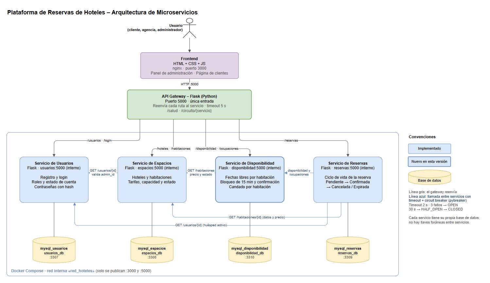

#  Definición de Servicios del Sistema

> El diagrama se puede editar abriendo `ArquitecturaReservas.drawio.png` en draw.io (diagrams.net): el archivo trae el diagrama incrustado.

---

##  Servicios del sistema

### 0.  API Gateway
* **Responsabilidad Principal:**
  Ser la única puerta de entrada al sistema. Recibe todas las peticiones del frontend y las reenvía al servicio que corresponde según la ruta.
* **Tecnología:** Flask (Python), puerto 5000 (único puerto de la API publicado hacia el exterior).
* **Información que Manejará:**
  * No guarda datos. Solo conoce la dirección de cada servicio.
* **Funciones adicionales:**
  * Timeout de 5 segundos por petición: responde `504` si el servicio tarda y `503` si está caído.
  * `GET /salud`: indica qué servicios están en línea.
  * `GET /circuito/{servicio}`: muestra el estado de los circuit breakers de un servicio.
* **Comunicación con otros Servicios:**
  * **Usuarios:** `/usuarios`, `/login`.
  * **Espacios:** `/hoteles`, `/habitaciones`.
  * **Disponibilidad:** `/disponibilidad`, `/ocupaciones`.
  * **Reservas:** `/reservas`.

---

### 1.  Servicio de Usuarios
* **Responsabilidad Principal:**
  Gestionar el inicio de sesión, la creación y administración de cuentas y la asignación de roles de acceso.
* **Tecnología:** Flask (Python), `usuarios:5000` en la red interna, base de datos `usuarios_db`.
* **Información que Manejará:**
  * Datos personales (Nombres, Apellidos, Teléfono, Correo).
  * Credenciales de acceso (Contraseñas con hash).
  * Roles del sistema (Cliente / Agencia / Administrador de hotel / Administrador del sistema).
  * Estado de la cuenta (Activa / Inactiva).
* **Comunicación con otros Servicios:**
  * **Ninguna saliente:** no llama a otros servicios.
  * **Responde a:** Espacios (validar el administrador de un hotel) y Reservas (validar al huésped).

---

### 2.  Servicio de Espacios (Hoteles y Habitaciones)
* **Responsabilidad Principal:**
  Administrar el catálogo de hoteles y sus habitaciones, con sus tarifas, capacidad y estado.
* **Tecnología:** Flask (Python), `espacios:5000` en la red interna, base de datos `espacios_db`.
* **Información que Manejará:**
  * Datos del hotel (Nombre, Ciudad, Dirección, Descripción, Servicios, Contacto, Administrador).
  * Habitaciones (Número, Tipo, Capacidad máxima, Amenidades, Estado).
  * Tarifa por noche.
* **Comunicación con otros Servicios:**
  * **Servicio de Usuarios:** al crear un hotel consulta `GET /usuarios/{id}` para validar que el administrador existe (con timeout y circuit breaker).
  * **Responde a:** Disponibilidad y Reservas, que consultan los datos y el precio de las habitaciones.

---

### 3.  Servicio de Disponibilidad
* **Responsabilidad Principal:**
  Llevar el calendario de ocupación de cada habitación: calcular qué habitaciones están libres en unas fechas, apartarlas durante 15 minutos mientras se completa una reserva, confirmarlas y liberarlas.
* **Tecnología:** Flask (Python), `disponibilidad:5000` en la red interna, base de datos `disponibilidad_db`.
* **Información que Manejará:**
  * Ocupaciones: habitación, fecha de entrada y de salida.
  * Tipo de ocupación (*Bloqueo* de 15 minutos / *Confirmada*).
  * Vencimiento del bloqueo y reserva asociada.
* **Reglas principales:**
  * Una ocupación cuenta si está confirmada o si es un bloqueo que todavía no vence.
  * Para evitar reservas duplicadas, al apartar una habitación toma un candado de MySQL por habitación: si dos personas la apartan al mismo tiempo, la segunda espera y recibe `409`.
* **Comunicación con otros Servicios:**
  * **Servicio de Espacios:** consulta las habitaciones candidatas (`GET /habitaciones`) y los datos de una habitación (`GET /habitaciones/{id}`), con timeout y circuit breaker.
  * **Responde a:** Reservas, que aparta, confirma, cambia y libera las fechas.

---

### 4.  Servicio de Reservas
* **Responsabilidad Principal:**
  Procesar y administrar el ciclo de vida completo de las reservas.
* **Tecnología:** Flask (Python), `reservas:5000` en la red interna, base de datos `reservas_db`.
* **Información que Manejará:**
  * Identificador único de reserva (ID).
  * Referencia al cliente (ID de Usuario), a la habitación y a la ocupación en Disponibilidad.
  * Rango de fechas (check-in / check-out) y número de huéspedes.
  * Monto total de la estancia.
  * Estado de la reserva (*Pendiente*, *Confirmada*, *Cancelada*, *Expirada*).
* **Comunicación con otros Servicios** (todas con timeout y circuit breaker):
  * **Servicio de Usuarios:** valida que el huésped exista y su cuenta esté activa.
  * **Servicio de Espacios:** obtiene el hotel, la habitación, su capacidad y su precio.
  * **Servicio de Disponibilidad:** consulta si la habitación está libre, aparta las fechas al crear la reserva, las confirma al confirmarla y las libera al cancelarla o eliminarla.

---

##  Resumen de Comunicación e Interconexión

| Servicio que solicita | Servicio que responde | Endpoint | Para qué |
| --- | --- | --- | --- |
| Frontend | API Gateway | Todas las rutas | Única entrada al sistema |
| API Gateway | Usuarios, Espacios, Disponibilidad, Reservas | La misma ruta recibida | Reenviar la petición |
| Espacios | Usuarios | `GET /usuarios/{id}` | Validar el administrador de un hotel |
| Disponibilidad | Espacios | `GET /habitaciones`, `GET /habitaciones/{id}` | Habitaciones candidatas, precio y estado |
| Reservas | Usuarios | `GET /usuarios/{id}` | Validar que el huésped existe y está activo |
| Reservas | Espacios | `GET /habitaciones/{id}` | Datos de la habitación y precio por noche |
| Reservas | Disponibilidad | `GET /disponibilidad/habitaciones/{id}` | Saber si está libre y el precio total |
| Reservas | Disponibilidad | `POST /ocupaciones`, `POST /ocupaciones/{id}/confirmar`, `PUT` y `DELETE /ocupaciones/{id}` | Apartar, confirmar, cambiar y liberar fechas |

**Resiliencia:** toda llamada entre servicios usa **timeout** (2 s) y un **circuit breaker** (`pybreaker`). Tras 3 fallos seguidos el circuito pasa a `OPEN` y responde `503` de inmediato durante 30 segundos, sin esperar al servicio caído; después pasa a `HALF_OPEN` y deja pasar una llamada de prueba: si funciona vuelve a `CLOSED`.

**Red:** todos los contenedores comparten la red que crea Docker Compose por defecto y se llaman por nombre (`http://espacios:5000`). Solo el frontend (3000) y el gateway (5000) publican puertos.

**Datos:** cada servicio tiene su propia base de datos MySQL. No hay llaves foráneas entre servicios: los identificadores que apuntan a otro servicio (`admin_id`, `usuario_id`, `habitacion_id`, `ocupacion_id`) se validan llamando a ese servicio.
